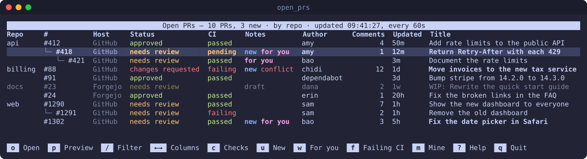
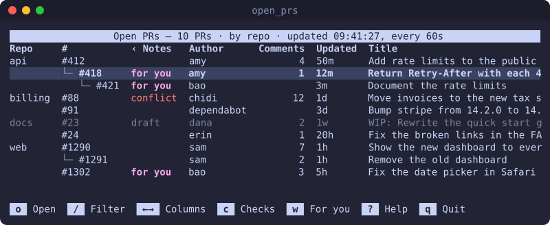
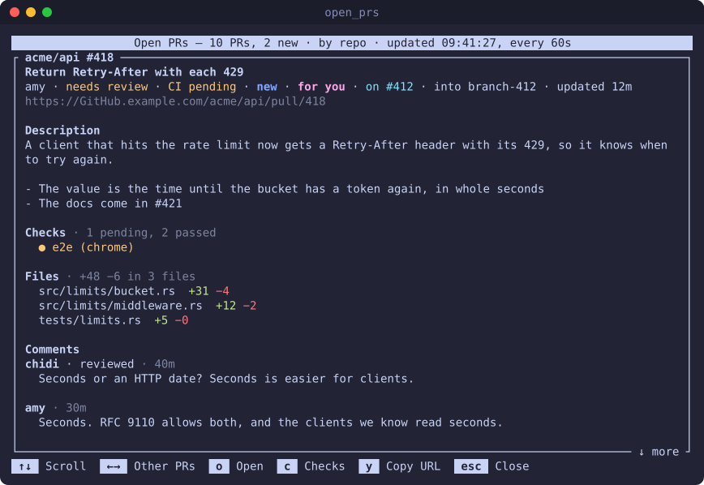
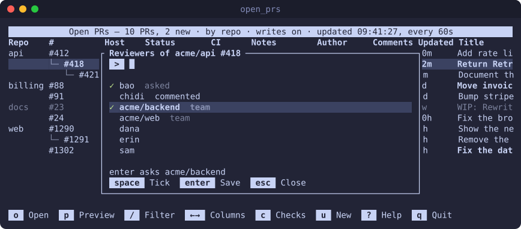
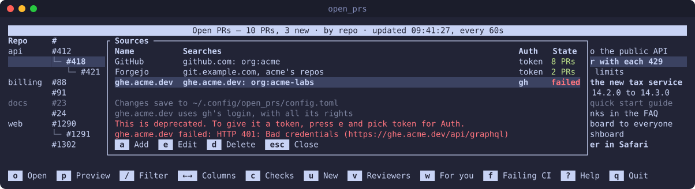

# open_prs

[](https://github.com/carlos-alberto/open-prs/actions/workflows/ci.yml)

A TUI that lists the open PRs on GitHub, Forgejo and Gitea, with their review status, CI
status and comments, and shows which PRs are stacked on which.



- One list for many GitHub searches and Forgejo or Gitea logins
- Review status, CI, review requests for you, drafts and merge conflicts
- PRs that changed since you last saw them are bold, and marked `new`
- `p` previews a PR: its description, the checks that didn't pass, the files and the last
  comments
- `v` asks people or teams to review a PR, or stops asking them
- Desktop notifications when a PR asks for your review, and when one of yours gets approved,
  gets changes requested or starts to fail CI
- Stacked PRs show as a tree under the PR they are on
- Filters for your PRs, approved PRs, PRs that need review, review requests, new PRs,
  failing CI and drafts, and a text filter
- `enter` opens the PR, `c` opens its CI runs and `y` copies its URL
- Add, edit and delete sources in the TUI; changes save to the config file and keep its
  comments
- It reloads every minute and keeps the cursor on the same PR
- A tab-separated list when stdout isn't a terminal, for scripts

The screenshots show made-up PRs.

## Install

```
cargo install --git https://github.com/carlos-alberto/open-prs
```

This puts `open_prs` in `~/.cargo/bin`. It needs:

- [`gh`](https://cli.github.com), logged in, for GitHub sources
- [`tea`](https://gitea.com/gitea/tea), with a login, for Forgejo and Gitea sources

## Usage

```
open_prs [-m/--mine] [-a/--approved | -n/--needs-review] [-w/--for-you] [-u/--new]
         [-f/--failing] [-d/--hide-drafts] [--text WORDS] [-g/--group repo|user]
         [-i/--interval SECONDS] [--no-notify] [--github QUERY]... [--forgejo LOGIN]...
```

With no sources, it shows the PRs on github.com that involve you. The flags set how the TUI
starts. The keys `m`, `a`, `n`, `w`, `u`, `f`, `d` and `g` toggle them while it runs, and `/`
changes the words. It reloads every SECONDS (default 60).

| Key | Action |
|-----|--------|
| `enter`, `o`, click the cursor row | Open the PR in the browser, and mark it as seen |
| `p` | Preview the PR, and mark it as seen |
| `c` | Open the PR's CI runs |
| `v` | Ask people to review the PR, or stop asking them |
| `/` | Filter by words in the repo, number, title, author or host; `enter` keeps them, `esc` clears them |
| `esc` | Clear the words |
| `y` | Copy the PR's URL |
| `r` | Reload now |
| `m` | Only PRs you opened |
| `a` / `n` | Only approved PRs / only PRs that need review |
| `w` | Only PRs that ask for your review |
| `u` | Only PRs that changed since you last saw them |
| `f` | Only PRs with failing CI |
| `d` | Hide drafts |
| `g` | Group by repo or by author |
| `s` | Add, edit and delete sources |
| `space` | Mark the PR as seen, or as new again |
| `↑` `↓` `PgUp` `PgDn` `Home` `End`, scroll | Move the cursor |
| `←` `→`, sideways scroll | Scroll the columns; Repo and # stay |
| `?` | Show every key |
| `q`, `ctrl+c` | Quit |

The footer shows as many keys as fit, and `?` shows them all.

## The table

The CI column is `passed`, `failing` or `pending`, and blank when the last commit has no
checks. The Notes column says when a PR changed since you last saw it (`new`), asks for your
review (`for you`, which on GitHub includes requests to your teams), is a `draft`, or has a
`conflict` with its base branch. Drafts are dim.

The Comments column has the number that the host shows next to the PR in its own list, and
is blank for none. GitHub counts the comments in the conversation and the inline comments on
the code. Forgejo counts each comment in the conversation and each review, also an approval
with no text, but not the inline comments.

The Host column shows only when the PRs come from more than one host. The table leaves out
the owner when every PR has the same one. When two sources find the same PR, it shows once,
from the first source.

On Forgejo, `c` opens the repo's list of action runs, as there is no checks page per PR.

### New activity

A PR is `new` when it changed since you last opened it or previewed it: a new commit,
comment or review, or a new title. Its title is bold, and the header counts them. `u` shows
only these, and `space` marks the PR under the cursor as seen, or as new again. A PR that
opens is new too.

The first time a source loads, its PRs count as seen, so a first run or a new source
doesn't mark everything. `$XDG_STATE_HOME/open_prs/seen.json`, else
`~/.local/state/open_prs/seen.json`, keeps when you last saw each PR. The host decides
what counts as a change, so your own comments also make a PR new.

### Stacks

A PR whose base is another open PR's branch is stacked on it, and that PR merges first.
Grouped by repo, a stacked PR shows under the PR it is on, joined to it by lines. In the
screenshot, api #421 is on #418, which is on #412.

When the tree can't show it, because the PRs are grouped by user or a filter hides the PR it
is on, the Notes column says `on #N`. A branch from a fork can't have PRs stacked on it.

### Narrow terminals

When the title has less than 25 columns, the table puts one space between the columns and
shortens `changes requested` to `changes`. Nothing else hides: `→` scrolls the columns after
`#` to the left, so the title gets their room, and `‹` shows that some are hidden. `←`
brings them back.



## Notifications

After the first load of each source, each reload sends a desktop notification when a PR
starts to ask for your review, and when one of your PRs gets approved, gets changes
requested, or starts to fail CI. One reload sends three at most: when more PRs changed, the
third says how many. A PR that two sources find sends one.

On macOS it uses `osascript`, so the notifications come from Script Editor; if none show,
allow notifications for Script Editor in System Settings. On Linux it uses `notify-send`.
Without either, it asks the terminal to show one (OSC 9), which some terminals do.
`--no-notify` turns them off.

## Preview

`p` shows the PR under the cursor: its description, the checks on its last commit that
didn't pass, the files it changes, and its last 10 comments and reviews. `↑` `↓` `PgUp`
`PgDn` scroll, `←` `→` go to the PR above or below in the table, and `esc` goes back. `o`,
`c` and `y` work as in the table.



It loads each time it opens, and shows the last preview of that PR while it loads. On
Forgejo and Gitea, tea doesn't give the files or each check, so the preview shows the CI
state of them all.

## Reviewers

`v` shows who the PR asks for a review, with a tick, and the people who can review it. Type
to filter the names, `space` ticks or unticks the name under the cursor, and `enter` saves.
With nothing ticked yet, `enter` ticks the name under the cursor first, so `v`, a name and
`enter` asks one person or team. A team is `org/team`, and the words match its name after
the `/`, so `eng` finds `acme/engineering`. A name that isn't in the list shows as typed,
for someone it doesn't know.



The host tells each person it asks, so the panel says what `enter` does before you press
it. On GitHub, the list has GitHub's suggestions, then the teams with access to the repo,
then the users who can be assigned in it. tea can't list who can review on Forgejo and
Gitea, so there the list has the authors of the source's PRs and the PR's reviewers, and no
teams.

## Sources

Each source is a GitHub search or a tea login. They come from, in order:

1. `--github QUERY` and `--forgejo LOGIN`, each as many times as you like. Changes made with
   `s` last until you quit.
2. `$XDG_CONFIG_HOME/open_prs/config.toml`, else `~/.config/open_prs/config.toml`. Changes
   made with `s` save to this file, and keep its comments.
3. Neither: one GitHub search for `involves:@me`.

```toml
[[source]]
kind = "github"
query = "org:rust-lang"        # GitHub search qualifiers; default involves:@me
# hostname = "ghe.example.com" # for GitHub Enterprise
# name = "Rust"                # the Host column; default GitHub, or the hostname

[[source]]
kind = "forgejo"               # or "gitea"
login = "codeberg.org"         # a name from `tea logins list`
owner = "forgejo"              # only this user's or org's repos; without it, a public
                               # instance gives the PRs of every public repo
# name = "Codeberg"            # default: the login
```

`s` shows each source, how many PRs it found, and the error of a source that failed:



## Plain output

When stdout isn't a terminal, it prints one tab-separated line per PR instead: host, repo,
number, status, author, title, url, ci, notes, comments. The notes have commas between them.
It exits 1 if a source failed. It reads what you saw, for `new`, but doesn't change it.

```
$ open_prs --github org:acme --failing | cut -f 1-5,8,9
GitHub	acme/billing	88	changes requested	chidi	failing	conflict
GitHub	acme/web	1291	needs review	sam	failing	on #1290
```

## Development

```
cargo test
cargo clippy --all-targets
cargo test screenshots -- --ignored   # draws docs/*.svg again
```

The screenshots are the real TUI, drawn with the made-up PRs in `src/screenshots.rs`. CI
runs these on each push and PR, and fails when the screenshots don't match the code.

## License

Licensed under either of [Apache License, Version 2.0](LICENSE-APACHE) or
[MIT license](LICENSE-MIT) at your option.

Unless you explicitly state otherwise, any contribution intentionally submitted for
inclusion in this project by you, as defined in the Apache-2.0 license, shall be dual
licensed as above, without any additional terms or conditions.
